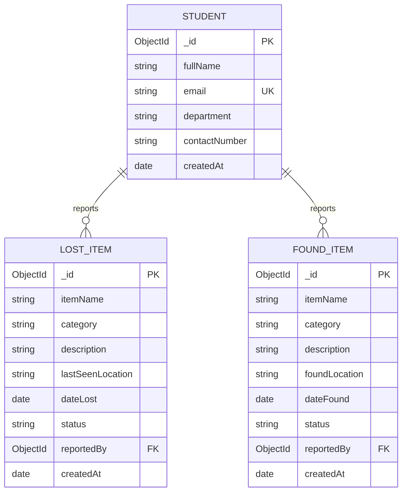

# Campus Lost & Found Management System (Phase 1)

A full-stack web application designed for college campuses to help students report lost personal items, register found items, and view individual student profiles and their associated reports. Built strictly using Node.js, Express.js, EJS, and MongoDB / Mongoose as specified in the assignment guidelines.

---

## 1. Project Purpose & Technologies

### Purpose
At college campuses, students frequently misplace belongings (ID cards, earphones, chargers, water bottles, keys, etc.) and post messages across disjointed chat groups. This application provides a centralized, database-backed platform with dynamic server-rendered pages where students can:
1. Register verified student profiles.
2. Report lost belongings with locations, dates, and descriptions.
3. Report found items to help reunite them with their owners.
4. View comprehensive details, dynamic counts, and individual student profiles with all items linked to them.

### Technologies
- **Runtime Environment:** Node.js (v18+)
- **Backend Framework:** Express.js (v5)
- **Templating Engine:** EJS (Embedded JavaScript)
- **Database:** MongoDB (Local or MongoDB Atlas)
- **Object Data Modeling (ODM):** Mongoose (v9)
- **Environment Management:** `dotenv`
- **Styling:** Custom Vanilla CSS (Responsive, modern layout, accessible UI)

---

## 2. Installation & Setup Instructions

### Prerequisites
- Node.js installed on your machine
- MongoDB Atlas cluster URL or local MongoDB instance

### Step-by-Step Setup
1. **Clone or navigate to the repository:**
   ```bash
   cd campus-lost-found
   ```

2. **Install project dependencies:**
   ```bash
   npm install
   ```

3. **Configure Environment Variables:**
   Copy the `.env.example` file to `.env`:
   ```bash
   cp .env.example .env
   ```
   Open `.env` and configure your credentials:
   ```env
   PORT=3000
   MONGODB_URL=mongodb+srv://<username>:<password>@cluster0.mongodb.net/campus_lost_found?retryWrites=true&w=majority
   ```
   *(Note: The actual `.env` file is excluded from Git to prevent exposing credentials).*

4. **Run the Automated Phase 1 Test Suite:**
   ```bash
   npm test
   ```

5. **Start the Application:**
   - Production / Standard start:
     ```bash
     npm start
     ```
   - Development mode with auto-reload:
     ```bash
     npm run dev
     ```

6. **Access the Application:**
   Open your browser and navigate to:
   ```
   http://localhost:3000
   ```

---

## 3. Environment Variables

| Variable | Description | Example / Placeholder |
| :--- | :--- | :--- |
| `PORT` | Port number on which the Express server listens | `3000` |
| `MONGODB_URL` | MongoDB connection URI (Atlas or Local) | `mongodb+srv://<username>:<password>@cluster0.mongodb.net/campus_lost_found?retryWrites=true&w=majority` |

---

## 4. Models & Database Relationships

### `Student` Model (`models/Student.js`)
Represents a registered college student.
- `fullName`: String (Required, trimmed)
- `email`: String (Required, unique, trimmed, lowercase, validated using email regex)
- `department`: String (Required, trimmed)
- `contactNumber`: String (Required, trimmed)
- `createdAt` / `updatedAt`: Timestamps

### `LostItem` Model (`models/LostItem.js`)
Represents an item lost by a student.
- `itemName`: String (Required, trimmed)
- `category`: String (Required, trimmed, e.g. Electronics, Books, ID Card)
- `description`: String (Required, trimmed)
- `lastSeenLocation`: String (Required, trimmed)
- `dateLost`: Date (Required, default: `Date.now`)
- `status`: String (Default: `'Lost'`, enum: `['Lost', 'Recovered', 'Closed']`)
- `reportedBy`: `mongoose.Schema.Types.ObjectId` referencing `Student` (Required)
- `createdAt` / `updatedAt`: Timestamps

### `FoundItem` Model (`models/FoundItem.js`)
Represents an item found on campus.
- `itemName`: String (Required, trimmed)
- `category`: String (Required, trimmed)
- `description`: String (Required, trimmed)
- `foundLocation`: String (Required, trimmed)
- `dateFound`: Date (Required, default: `Date.now`)
- `status`: String (Default: `'Found'`, enum: `['Found', 'Claimed', 'Returned']`)
- `reportedBy`: `mongoose.Schema.Types.ObjectId` referencing `Student` (Required)
- `createdAt` / `updatedAt`: Timestamps

### Entity-Relationship Architecture


- **One-to-Many Relationships:**
  - One `Student` can report multiple `LostItem`s.
  - One `Student` can report multiple `FoundItem`s.
- **Foreign Key Referencing:**
  - `LostItem.reportedBy` and `FoundItem.reportedBy` store the MongoDB `_id` of a `Student`.
  - Mongoose `.populate('reportedBy')` dynamically joins student information without storing redundant data in items collections.
  - On the Student Profile page (`/students/:id`), reverse querying `LostItem.find({ reportedBy: student._id })` and `FoundItem.find({ reportedBy: student._id })` dynamically aggregates all items associated with that student.

---

## 5. Implemented Routes & HTTP Methods

| Method | Route | Description |
| :--- | :--- | :--- |
| `GET` | `/` | Dashboard displaying live MongoDB counts for Students, Lost Items, Found Items, and recent reports |
| `GET` | `/students` | Directory listing all registered students |
| `GET` | `/students/new` | Form to register a new student profile |
| `POST` | `/students` | Validates and creates a new student profile (rejects duplicates & invalid email) |
| `GET` | `/students/:id` | Dynamic route displaying individual student profile and all their reported lost & found items |
| `GET` | `/lost-items` | Dynamic listing of all lost items with search filter (by item name, description, location) and category filter |
| `GET` | `/lost-items/new` | Form to report a lost item (with student selector) |
| `POST` | `/lost-items` | Validates and saves a new lost-item report linked to a valid Student ObjectId |
| `GET` | `/lost-items/:id` | Dynamic route displaying full details of one lost item and populated reporter profile |
| `GET` | `/found-items` | Dynamic listing of all found items with search & category filters (gracefully handles empty states) |
| `GET` | `/found-items/new` | Form to report a found item (with student selector) |
| `POST` | `/found-items` | Validates and saves a new found-item report linked to a valid Student ObjectId |
| `GET` | `/found-items/:id` | Dynamic route displaying full details of one found item and populated reporter profile |
| `*` | Any unknown route | Custom `404.ejs` Not Found page with proper 404 HTTP status code |

---

## 6. Validation & Error Handling

1. **Required Fields & Whitespace Prevention:**
   All input strings are trimmed (`trim()`) before saving. Inputs consisting purely of whitespace are rejected with user-friendly error banners.
2. **Email Format & Duplicate Prevention:**
   - Evaluated against standard regex: `/^[^\s@]+@[^\s@]+\.[^\s@]+$/`.
   - Before inserting, queries `Student.findOne({ email })`. Duplicate entries are blocked at both the application level and the database level (`unique: true` index) with error code `11000`.
3. **MongoDB ObjectId Verification:**
   All dynamic route parameters (`:id` in `/students/:id`, `/lost-items/:id`, `/found-items/:id`) and reference IDs (`reportedBy`) are validated with `mongoose.Types.ObjectId.isValid(id)` before issuing database queries, preventing server crashes and casting exceptions.
4. **Missing Records (404 Handling):**
   If a valid ObjectId format is queried but does not exist in the collection, the application returns HTTP status `404` and renders `404.ejs` with a specific error message.
5. **Global Error Handling:**
   Centralized Express error middleware catches unexpected exceptions, Mongoose `ValidationError`s, and `CastError`s, responding with appropriate HTTP status codes (400, 404, 500) and user-friendly error views.

---

## 7. Instructor Demonstration Guide & Checklist

Use this guide when presenting Phase 1 to your instructor:

### Demonstration Steps:
1. **Initial Dashboard Check (`GET /`):**
   - Start the server (`npm start`).
   - Open `http://localhost:3000`.
   - Point out that the metrics cards display live database counts queried via `countDocuments()`.
2. **Student Registration (`POST /students`):**
   - Click **Register Student** (or go to `/students/new`).
   - Try submitting with empty fields or invalid email (e.g. `test`) &rarr; observe form validation rejection.
   - Enter valid details (e.g. "Rahul Sharma", "rahul.sharma@college.edu", "CSE", "9876543210") &rarr; submit.
   - Attempt to register the exact same email again &rarr; observe duplicate email error message.
3. **Dynamic Student Profile (`GET /students/:id`):**
   - View the created student's profile page.
   - Show the dynamic URL containing the unique MongoDB `_id`.
   - Test changing the ID in the URL to an invalid string (e.g. `/students/123invalid`) &rarr; observe custom `404.ejs` without server crash.
4. **Reporting a Lost Item (`POST /lost-items`):**
   - Click **Report Lost** (or go to `/lost-items/new`).
   - Fill in Item Name (e.g., "Dell Laptop Charger"), Category, Description, Location, and select the student.
   - Submit and verify automatic redirect to the newly created item's detail page (`/lost-items/:id`).
   - Point out that the reporter's name and details are populated dynamically via Mongoose `.populate('reportedBy')`.
5. **Dynamic Item Listing & Search / Filter (`GET /lost-items`):**
   - Visit `/lost-items`.
   - Show the dynamic card rendering.
   - Use the search bar to search by keyword or filter by category &rarr; show filtered results.
6. **Reporting a Found Item (`POST /found-items`):**
   - Click **Report Found** (or go to `/found-items/new`).
   - Fill in details (e.g., "Milton Water Bottle", "Cafeteria", etc.).
   - Submit and view the detail page (`/found-items/:id`).
7. **Empty-State Verification:**
   - Filter for a non-existent search term (e.g. `xyz999`) to show the clean empty-state message and action button.
8. **Student Profile Reverse Linkage:**
   - Return to the student's profile page (`/students/:id`).
   - Demonstrate that both the lost item and the found item reported by this student now automatically appear under their profile!

---

## 8. Answers to Common Evaluation Questions

- **Why is `reportedBy` an ObjectId instead of the student's name?**
  *Student names are not unique and can change. Storing a reference `ObjectId` pointing to the `Student` collection maintains normalization, avoids data redundancy, and enables `populate()`, ensuring all profile updates propagate automatically.*
- **How does the system prevent crashes when given an invalid MongoDB ID?**
  *Every dynamic route runs `mongoose.Types.ObjectId.isValid(req.params.id)`. If an ID has an incorrect length or non-hex characters, a clean HTTP 404 response is rendered immediately without executing a malformed query.*
- **Where are duplicate emails checked?**
  *In the application layer via `Student.findOne({ email })` before insertion, and in the database layer through the Mongoose schema `unique: true` index.*
